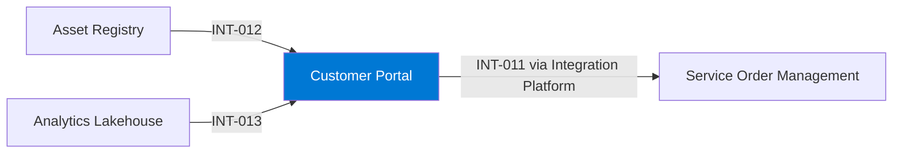

# Customer Portal

## Purpose

The Customer Portal gives customers an overview of their equipment, asset health and service history, and lets them raise service requests.

## Context

## Components

- Web front end on Azure Static Web Apps.
- Portal APIs behind API Management.

## Interfaces

| ID | Counterpart | Direction | Pattern | Status |
|---|---|---|---|---|
| INT-011 | Service Order Management | outbound | API | active |
| INT-012 | Asset Registry | inbound | API | active |
| INT-013 | Analytics Lakehouse | inbound | API | active |

## Data

| Data product | Role | Classification |
|---|---|---|
| DP-003 Installed Base | consumes | Internal |
| DP-001 Asset Health Score | consumes | Internal |

## Security and access

- Customers sign in with Entra External ID; every API call is scoped to the customer account.
- Portal APIs are published through API Management with rate limits per customer.

## Operations

- Monitoring: availability tests and real user monitoring.
- Support: Digital Customer Experience; P1 24/7.

## Known limitations

- Spare parts ordering is not yet available in the portal.

## Change log

| Date | Version | Change | Author |
|---|---|---|---|
| 2026-08-20 | 2.0 | Asset health dashboards | Digital Customer Experience |
