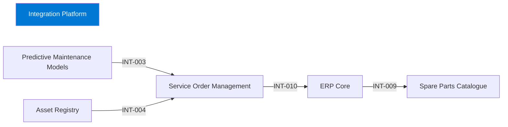

# Integration Platform

## Purpose

The Integration Platform connects business systems through APIs, events and scheduled transfers so that systems do not integrate point to point.

## Context

## Components

- iPaaS runtime with API, event and batch connectors.
- Shared monitoring dashboard for all integrations.

## Interfaces

| ID | Counterpart | Direction | Pattern | Status |
|---|---|---|---|---|
| INT-003 | Predictive Maintenance Models → Service Order Management | via | API | active |
| INT-004 | Asset Registry → Service Order Management | via | API | active |
| INT-009 | ERP Core → Spare Parts Catalogue | via | batch | active |
| INT-010 | Service Order Management → ERP Core | via | event | active |

## Data

The Integration Platform does not own data products; it transports them.

## Security and access

- Each integration uses its own client credentials stored in the platform's vault.
- Inbound APIs require OAuth tokens; IP restrictions for on-premises connectors.

## Operations

- Monitoring: platform dashboard; alerts to Integration Services on failed runs.
- Support: Integration Services, 24/7 for critical flows.

## Known limitations

- Event replay is limited to 3 days.

## Change log

| Date | Version | Change | Author |
|---|---|---|---|
| 2024-11-30 | 2.1 | Added service billing INT-010 | Integration Services |
