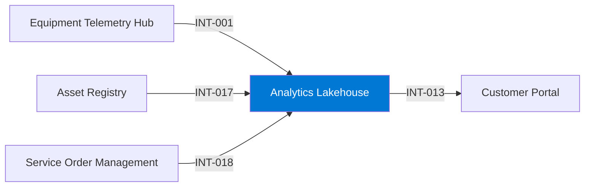

# Analytics Lakehouse

## Purpose

The Analytics Lakehouse hosts curated data products and reporting models for the whole company and serves asset health data to the Customer Portal.

## Context

## Components

- Delta tables organised in bronze, silver and gold layers.
- Semantic models for reporting.
- Serving API for asset health.

## Interfaces

| ID | Counterpart | Direction | Pattern | Status |
|---|---|---|---|---|
| INT-001 | Equipment Telemetry Hub | inbound | event stream | active |
| INT-013 | Customer Portal | outbound | API | active |
| INT-017 | Asset Registry | inbound | batch | active |
| INT-018 | Service Order Management | inbound | batch | active |

## Data

| Data product | Role | Classification |
|---|---|---|
| DP-005 Telemetry Aggregates | consumes | Internal |
| DP-003 Installed Base | consumes | Internal |
| DP-002 Service Order History | consumes | Confidential |
| DP-001 Asset Health Score | serves | Internal |

## Security and access

- Workspace roles per data domain; Confidential data products have row-level security.
- Service principals for pipelines; no personal accounts in pipelines.

## Operations

- Monitoring: pipeline failure alerts and daily freshness checks per data product.
- Support: Data Platform, business hours.

## Known limitations

- Freshness of DP-002 is one day.

## Change log

| Date | Version | Change | Author |
|---|---|---|---|
| 2026-06-30 | 1.8 | Added service order history | Data Platform |
