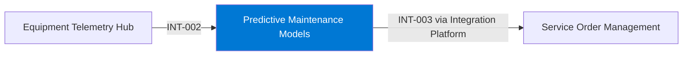

# Predictive Maintenance Models

## Purpose

The Predictive Maintenance Models score the health of machine components from telemetry and service history and recommend maintenance actions to service planning.

## Context

## Components

- Feature pipeline in the Analytics Lakehouse.
- Model training and registry in Azure Machine Learning.
- Batch scoring job every hour; results published as data product DP-001.

## Interfaces

| ID | Counterpart | Direction | Pattern | Status |
|---|---|---|---|---|
| INT-002 | Equipment Telemetry Hub | inbound | event stream | active |
| INT-003 | Service Order Management | outbound | API | active |

## Data

| Data product | Role | Classification |
|---|---|---|
| DP-005 Telemetry Aggregates | consumes | Internal |
| DP-002 Service Order History | consumes | Confidential |
| DP-001 Asset Health Score | produces | Public |

## Security and access

- Training data access through the lakehouse with workspace identities.
- Scoring endpoint is private; recommendations leave only through the Integration Platform.

## Operations

- Monitoring: model drift report weekly; scoring job alerts on failure.
- Support: Data Science CoE, business hours.

## Known limitations

- Models cover drive motors, brakes and bearings only.
- Recommendations for machines without telemetry rely on service history alone.

## Change log

| Date | Version | Change | Author |
|---|---|---|---|
| 2026-07-01 | 1.6 | Added wire rope model | Data Science CoE |
