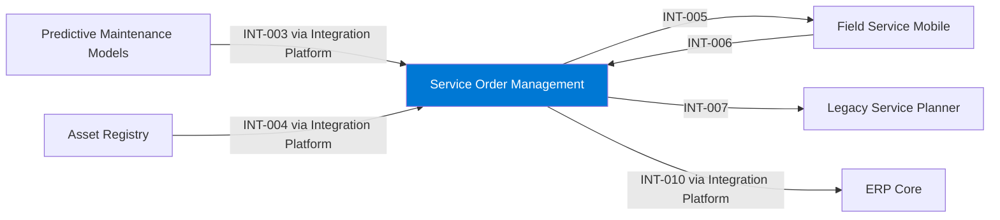

# Service Order Management

## Purpose

Service Order Management is the system of record for service requests, work orders and technician scheduling. Service coordinators plan work here and technicians receive their assignments through Field Service Mobile.

## Context

## Components

- Field service platform (SaaS) – work orders, scheduling, service history.
- Extension functions – Azure Functions for integrations that the SaaS cannot do natively.
- Planning export – nightly file export to the Legacy Service Planner for capacity planning.

## Interfaces

| ID | Counterpart | Direction | Pattern | Status |
|---|---|---|---|---|
| INT-003 | Predictive Maintenance Models | inbound | API | active |
| INT-004 | Asset Registry | inbound | API | active |
| INT-005 | Field Service Mobile | outbound | API | active |
| INT-006 | Field Service Mobile | inbound | API | active |
| INT-007 | Legacy Service Planner | outbound | file | active |
| INT-010 | ERP Core | outbound | event | active |

## Data

| Data product | Role | Classification |
|---|---|---|
| DP-002 Service Order History | produces | Confidential |
| DP-003 Installed Base | consumes | Internal |
| DP-001 Asset Health Score | consumes | Internal |

## Security and access

- Users sign in with Entra ID single sign-on; roles are managed in the SaaS platform.
- Integrations call the platform through the Integration Platform with OAuth client credentials.
- Customer names and site addresses are Confidential.

## Operations

- Monitoring: SaaS vendor status page and Integration Platform alerts.
- Support: Service Operations IT, business hours.

## Known limitations

- Capacity planning depends on the nightly export to the Legacy Service Planner.
- No real-time view of asset health; recommendations arrive hourly.

## Change log

| Date | Version | Change | Author |
|---|---|---|---|
| 2025-03-14 | 1.3 | Added maintenance recommendations INT-003 | Service Operations IT |
| 2024-10-02 | 1.2 | Billing via Integration Platform | Service Operations IT |
