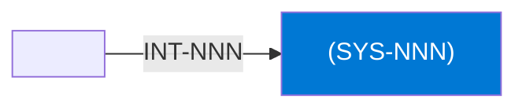

# <System name>

## Purpose

<What the system does and for whom, in 2–4 sentences.>

## Context

## Components

- <Component> – <role, hosting>

## Interfaces

| ID | Counterpart | Direction | Pattern | Status |
|---|---|---|---|---|
| INT-NNN | <System> | inbound / outbound / via | API / event / batch / file | active |

## Data

| Data product | Role | Classification |
|---|---|---|
| DP-NNN <name> | produces / consumes | Internal |

## Security and access

- Authentication: <…>
- Authorisation: <…>
- Network exposure: <…>
- Secrets: stored in <…>; never in documentation.

## Operations

- Monitoring: <…>
- Support: <team, hours>

## Known limitations

- <…>

## Change log

| Date | Version | Change | Author |
|---|---|---|---|
| YYYY-MM-DD | 0.1 | First draft | <person / team / agent> |
