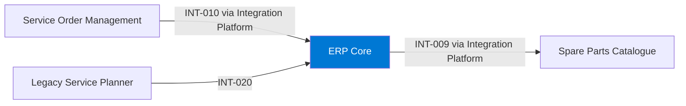

# ERP Core

## Purpose

ERP Core is the enterprise resource planning system for finance, procurement, inventory, sales orders and invoicing.

## Context

## Components

- On-premises ERP with private connectivity to Azure.

## Interfaces

| ID | Counterpart | Direction | Pattern | Status |
|---|---|---|---|---|
| INT-009 | Spare Parts Catalogue | outbound | batch | active |
| INT-010 | Service Order Management | inbound | event | active |
| INT-020 | Legacy Service Planner | inbound | file | active |

## Data

| Data product | Role | Classification |
|---|---|---|
| DP-004 Spare Parts Availability | produces | Internal |

## Security and access

- Access managed by the ERP Competence Center; integrations only through the Integration Platform.

## Operations

- Support: ERP Competence Center, 24/7 for month-end closing.

## Known limitations

- No real-time events for inventory changes.

## Change log

| Date | Version | Change | Author |
|---|---|---|---|
| 2026-10-23 | 0.1 | Generated from a spreadsheet export | coding-agent skill "erp-doc" |
