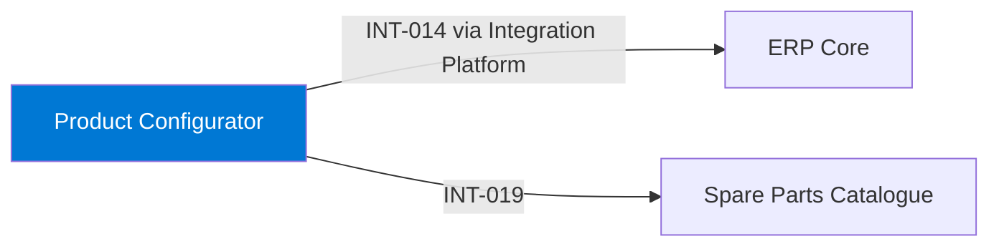

# Product Configurator

## Purpose

The Product Configurator lets sales configure machines and options for quotes. It produces configured bills of material that become sales orders in ERP Core and maps configured options to spare parts.

## Context

## Components

- Configure-price-quote SaaS tenant with product models maintained by product management.
- Order handover through the Integration Platform.

## Interfaces

| ID | Counterpart | Direction | Pattern | Status |
|---|---|---|---|---|
| INT-014 | ERP Core | outbound | API | active |
| INT-019 | Spare Parts Catalogue | outbound | API | active |

## Data

| Data product | Role | Classification |
|---|---|---|
| DP-006 Configured Product Structures | produces | Confidential |

## Security and access

- Sales users sign in with Entra ID single sign-on.
- Customer-specific prices are Confidential and visible only to the owning sales unit.

## Operations

- Monitoring: SaaS vendor status page; Integration Platform alerts on order handover failures.
- Support: Sales Tools, business hours.

## Known limitations

- Product models for legacy product families are not yet migrated.

## Change log

| Date | Version | Change | Author |
|---|---|---|---|
| 2026-10-20 | 0.1 | Generated from the system inventory | coding-agent skill "arch-doc-from-inventory" |
